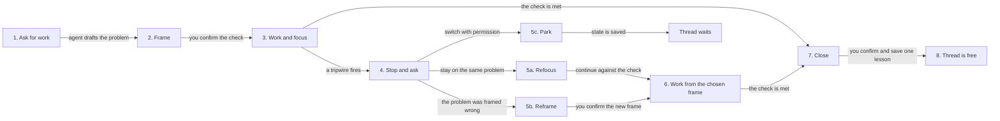
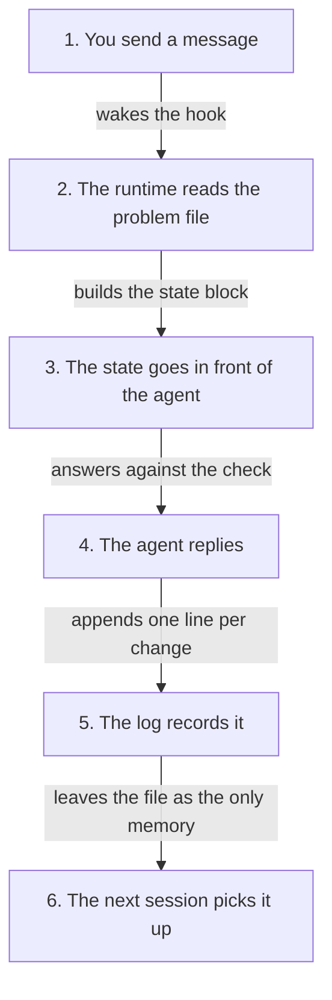

# agent-problem-solving

Agent Problem Solving is a plugin that helps you solve problems with your agent.

Use it to:

1. Clearly define a problem and what done means
2. Identify & understand available information + what (if any) is required but missing
3. Refine the problem as new information arrives
4. **NB!!** Keep the conversation on track to solve the problem.  

## Install

Run the line for your agent from the project where you want the reminder. The
installer creates `~/problems`, adds the four skills, installs `aps`, and wires
the reminder into that runtime. It stays out of every other project unless you
pass `--all-projects`.

### Claude Code

```bash
npx github:Rendiere/agent-problem-solving install claude-code --overlay ~/problems --agent me
```

**Codex**

```bash
npx github:Rendiere/agent-problem-solving install codex --overlay ~/problems --agent me
```

Codex installs the hook disabled. Type `/hooks` once, review it and trust it.

**OpenClaw**

```bash
npx github:Rendiere/agent-problem-solving install openclaw --overlay ~/problems --agents my-agent
```

Then restart the gateway.

**A runtime with no plugin hook**

```bash
npx skills add Rendiere/agent-problem-solving
```

`npx skills add` installs the skills only: it does not install `aps` or tell the
skills where your problem file lives. Use the fallback installer for a runtime
that follows `AGENTS.md`:

```bash
npx github:Rendiere/agent-problem-solving install agents-md --overlay ~/problems --agent me
```

That command installs the skills, `aps`, its settings and a written reminder.
The reminder still depends on the agent remembering to follow it. Claude Code,
Codex and OpenClaw run theirs before the agent sees your message.

Run any of them again with `--dry-run` first to see exactly which files change.
Nothing is overwritten without a timestamped backup beside it.

### Set up your first problem

The install command creates this file if it is missing:

```
~/problems/agents/me/PROBLEMS.md
```

Open it, finish the `Mission:` line, then check the install:

```bash
npx github:Rendiere/agent-problem-solving doctor --overlay ~/problems
```

## What you'll see

Say your problem file holds this:

```
Mission: ship the privacy page so sign-ups stop bouncing

## P1. Privacy page live
- status: active
- thread: dir:~/code/website
- done when: the page is live and the sign-up form links to it
```

You open the agent in `~/code/website` and ask it to look at the pricing page.
Before it answers, it has already read that file, and it opens with:

> 🧭 I noticed we're veering off P1 Privacy page live: pricing isn't what
> gets the page live. Want to 1. get back to it, 2. reframe the problem, or
> 3. park it and switch?

You answer with a number. Whatever you choose is written into the file and into
an append-only log. Tomorrow's session has none of this conversation in it, and
it still opens by naming the problem it is back on.

## How it works

A problem moves through the phases below. You decide every status change; the
agent drafts the entry, keeps watch for drift and asks before it switches.



1. Ask for work. Anything needing more than a direct answer. A fact or a
   reminder is just answered and nothing is written down for it.
2. Frame. The agent drafts one entry: what is wrong, and the check that would
   prove it fixed. It asks you to confirm before starting. You are the only one
   who can make a problem active.
3. Work and focus. The thread holds exactly one active problem, and every reply is
   measured against that one check.
4. Stop on a tripwire. A switch request, two pushbacks, two self-corrections, a
   stop-gap or the start of a build makes the agent stop and ask.
5. Choose the next frame. Stay on the problem, reframe it, or park it. The agent
   changes nothing until you answer.
6. Work from that choice. A parked problem keeps its state; a reframed problem
   gets a new check; a refocused problem continues against the old one.
7. Close. The agent asks only when the check is met. With your yes, it marks the
   problem done and saves one lesson.
8. The thread is free for the next problem.

A small task that has to happen before the main one gets its own entry and
pauses its parent, which resumes when the small one closes. So "quick script
first" cannot quietly become the thing you are doing.

### What happens on one turn



1. You send a message. An ordinary one; you do nothing differently.
2. The runtime reads the problem file. This is the part that does not depend on
   the agent. A drifting agent will not invoke the skill that would catch its
   drift, so the reading is not left to it.
3. The state goes in front of the agent: roughly three hundred tokens holding the
   mission, which problem this thread is on, the check that would end it, and any
   question still waiting on your answer.
4. The agent replies, with one test in front of it. Does this reply move the
   check?
5. The log records any change, one line each, appended and never edited.
6. The next session picks it up. A reset, a new session or a compaction costs
   nothing, because the file outlived all three. The next reply opens by naming
   the problem it is back on.

Step 6 is why the problem lives in a file. Sessions end and context windows
fill; a file survives both, and a problem usually outlasts the session it
started in.

## The commands

```bash
aps set P1 status=parked state='waiting on their reply'   # change a status
aps lint                                                  # is the register valid?
aps report                                                # parked, stale, waiting
aps doctor                                                # is the install sound?
aps install --status                                      # what is installed where
```

`aps set` refuses a second active problem on one thread, stamps the date, and
writes the log. It needs no hook and no gateway, so the method works by hand on
any runtime that can read a file and run a command.

`aps report` is what you read in whatever evening routine you already have. The
plugin does not decide where that goes.

## Your problems stay yours

This repository holds the method: the skills, the file format, the reminder, the
commands. It does not identify any person, agent, chat, or business.

Your missions, problems and logs live in the directory you passed as `--overlay`,
which is yours to keep private or commit as you like:

```
<overlay>/agents/<agent>/PROBLEMS.md       what that agent is working on
<overlay>/agents/<agent>/decisions.jsonl   every change, appended
<overlay>/denylist.txt                     names that must never reach this repo
```

## Context

The reminder carries a token count against two levels, and nothing else: no
percentage, no ceiling, and it never blocks a turn. Past the first level the
agent offers you a fresh session at the next problem boundary: a close, a park
or a reframe, never mid-problem. Past the second it writes the state down and
offers a fresh session straight away. Where a runtime reports no token count, the gauge line is
left out.

## Not in here

Replacing your task tracker. A problem links to tickets and does not become one.
Chat-app adapters beyond OpenClaw's. A fixed context ceiling. Anything that
changes a problem's status without you saying yes.

## Early work

Built and tested: the file format, the commands, the three runtime adapters, the
decision log and the four skills. The pinned chat message and the weekly reviewer
are later stages.

```bash
npm test                                     # the suite
APS_OVERLAY=… npm test                       # also checks nothing of yours is in here
```

## Licence

MIT.
