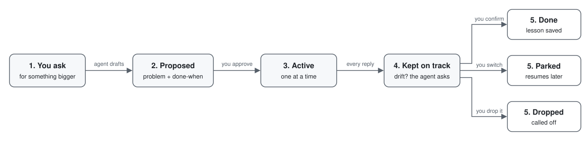

# agent-problem-solving

Agent Problem Solving is a plugin that helps you solve problems with your agent.

Use it to:

1. Clearly define a problem and what done means
2. Identify & understand available information + what (if any) is required but missing
3. Refine the problem as new information arrives
4. **NB!!** Keep the conversation on track to solve the problem.

It works with Claude Code, Codex and OpenClaw.

## What it looks like

You chat with your agent as usual. When you bring it a problem, the agent
writes the problem down before it starts, without you asking it to. When the
steps are obvious, as with adding a CSV export, it just does the work and
writes nothing down.

> **You:** Sign-ups dropped about 30% last month. Any idea why?

> **Agent:** Not yet, and finding out will take more than one reply, so I'd like to write it down first.
>
> P1. Find out why sign-ups fell
> - problem: sign-ups fell about 30% last month and nobody knows why
> - done when: we can name the step where the missing sign-ups drop out, with numbers from both months
> - rules out: changes to the sign-up flow until we know the cause
>
> 1. Approve
> 2. Reword
> 3. Not now

> **You:** 1

Half an hour later you ask for something unrelated:

> **You:** While you're in there, can you restyle the sidebar?

> **Agent:** Restyling the sidebar won't tell us where people drop out, so it's a
> new job. Park P1 Find out why sign-ups fell (both months' numbers pulled, drop-off
> step not found yet) and switch?
>
> 1. Park and switch
> 2. Stay on P1

If the work drifts off P1 and you haven't asked for anything new, the agent asks
the same way and adds an option to reword P1.

When the check passes, the agent shows you the evidence and asks before it
calls the problem done. Tomorrow's session opens on the same problem, because
the problem is stored in a file that every new session reads.

## How a problem moves



1. You bring a problem: something is off and the way to fix it isn't obvious
   yet. A quick fact or a task with clear steps just gets answered or done. If
   you keep telling the agent a task isn't quite what you want, it suggests
   writing it down as a problem.
2. The agent drafts the problem: what is wrong, and a check anyone could run to
   prove it fixed. It waits for you.
3. You approve it, and it becomes the active problem. Each project or chat
   thread has one active problem at a time.
4. Before every reply, the agent sees the active problem and its check. If the
   conversation drifts, or you push back twice, it stops and asks whether to go
   back, reword the problem, or park it.
5. The problem ends one of three ways. Done: the check passed, you confirmed,
   and the agent saved one line on what it learned. Parked: its state is
   written down, and it comes back when you return to it. Dropped: you called
   it off.

Nothing becomes active, done or dropped without your yes.

## Install

Run the command for your agent from inside the project you want it in:

```bash
npx github:Rendiere/agent-problem-solving install claude-code
npx github:Rendiere/agent-problem-solving install codex
npx github:Rendiere/agent-problem-solving install openclaw
```

Each command installs four skills, a hook that shows the agent the active
problem before every reply, and the `aps` command the agent uses to change a
problem. Add `--dry-run` to see which files would change; the installer backs up
any file before editing it.

After installing:

- Codex installs the hook switched off. Type `/hooks` once to review and trust it.
- OpenClaw needs a gateway restart.

If you run several named agents, give each its own problems with
`--agent <name>` (or `--agents a,b` for OpenClaw). With one agent you can leave
it out.

For any other agent, `npx skills add Rendiere/agent-problem-solving` installs
the skills on their own. Without the hook, the agent has to remember to read
its problems. [docs/reference.md](docs/reference.md) covers the `aps` command
and the file format.

## Where your problems are stored

The installer asks where to keep your problems and offers a numbered list. Which
places it offers depends on the agent you install for:

- `.problems` in the repository you ran it from, when that is a git repository
- `~/.claude/problems` for Claude Code
- `~/.codex/problems` for Codex
- `problems` in the OpenClaw workspace for OpenClaw

Press Enter to take the first place, type a number to pick another, or type
any path. `--overlay <path>` sets the place without asking, and `--yes` takes
the first one. A `.problems` folder inside your repository can be committed or
added to `.gitignore`, whichever you prefer.

The folder holds one problem file per agent, at `agents/<name>/PROBLEMS.md`,
and a log of every change beside it in `decisions.jsonl`. The name is `default`
unless you pass `--agent`. The installer records the folder in
`~/.config/aps/config.json`, and for OpenClaw in OpenClaw's own config too. The
hook and the `aps` command look it up there.

To move your problems later, move the folder, then run the install command again
with `--overlay <new path>`. A re-run offers the folder already in use as the
first choice, so taking the default keeps everything where it is. If the new
folder has no problem file yet, the installer starts an empty one there.

## Licence

MIT.
